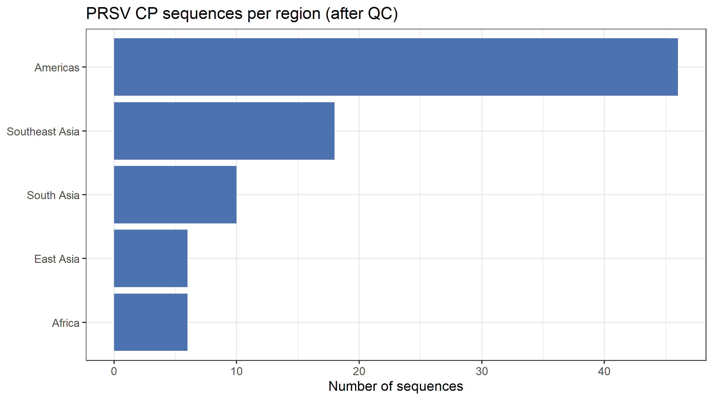
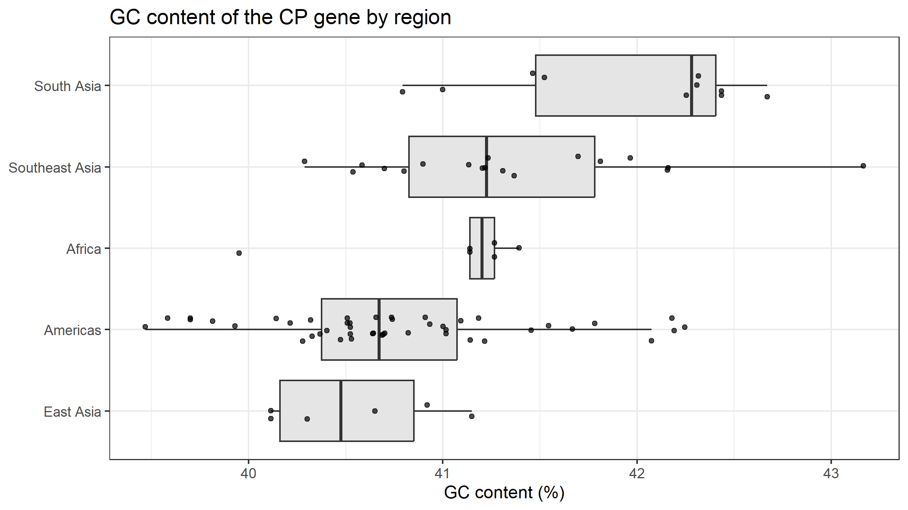
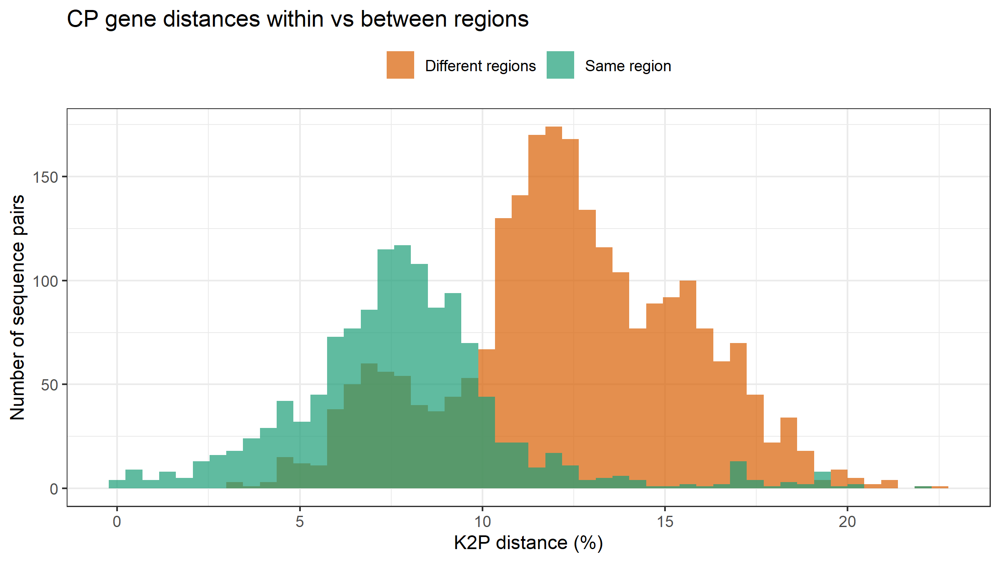
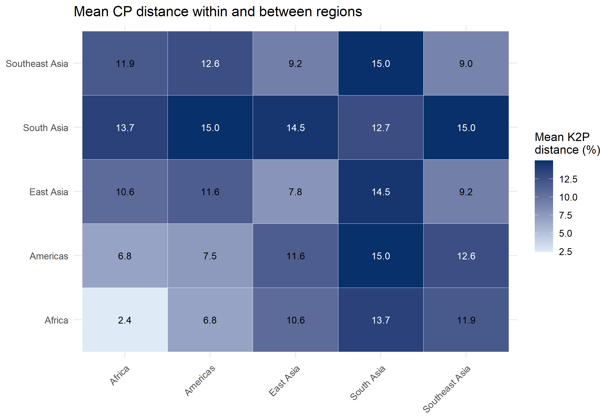
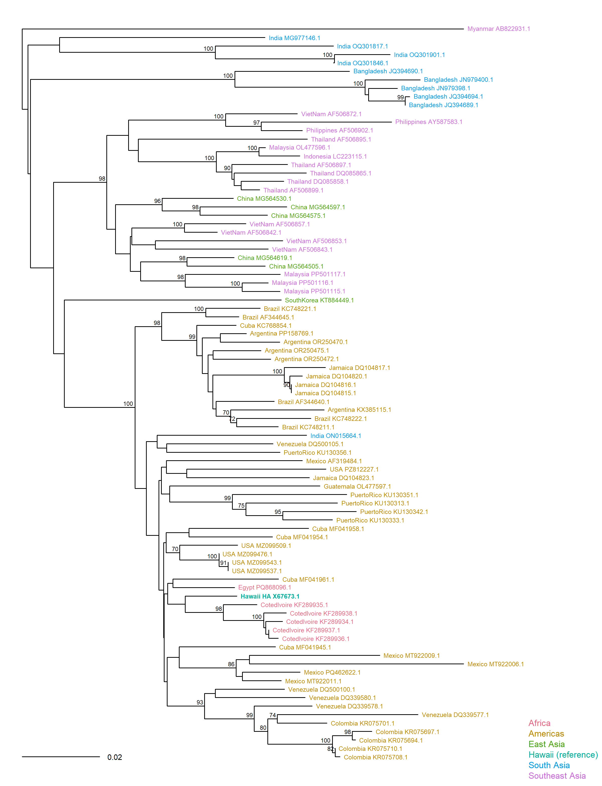
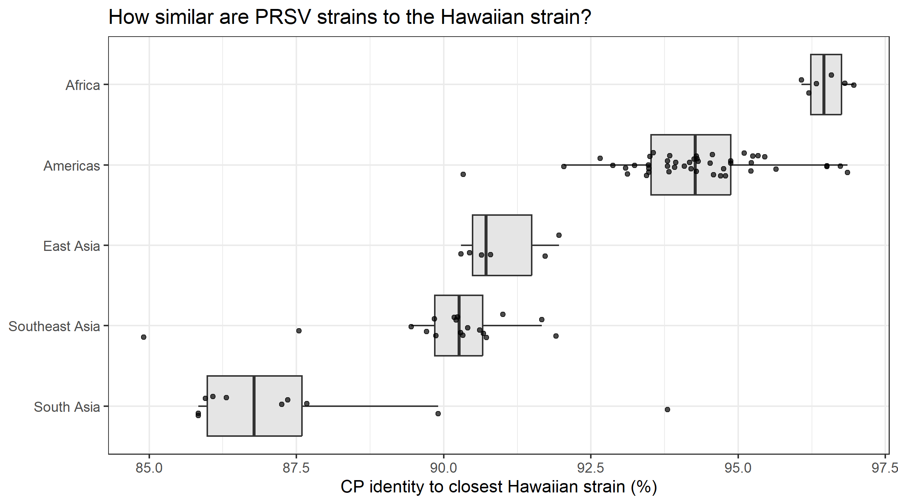

# How different are papaya ringspot virus strains around the world? 
### A coat-protein gene analysis for virus-resistant papaya

**Author:** R. Y. N. Wijesinghe (2021ICT39)
**Module:** Bioinformatics, ICA3, University of Vavuniya
**Analysis code:** [`code/analysis.Rmd`](code/analysis.Rmd) 
**Rendered notebook:** [`code/analysis.html`](code/analysis.html)

---

## Abstract

*Papaya ringspot virus* (PRSV) is one of the most destructive diseases of papaya. Virus-resistant papaya developed in Hawaii carries the coat protein (CP) gene of a Hawaiian strain, and this resistance works best against strains with a similar CP sequence. Using public GenBank data in R, I compared 86 PRSV CP sequences from 22 countries in five world regions with each other and with the Hawaiian reference isolate HA. Sequences from different regions were more distant than those from the same region (mean K2P 12.3% vs 7.8%; Wilcoxon p < 10⁻²⁷²), and the tree showed clear regional groups. Identity to the Hawaiian strain differed between regions (p = 3.9 × 10⁻¹³): highest in Africa (96.5%) and the Americas (94.3%), lowest in South Asia (87.6%). Hawaiian-type resistant papaya is therefore least likely to suit South Asia, where resistance based on local strains is needed.

---

## 1. Introduction

### 1.1 The real-world problem

Papaya is an important fruit crop for food and income in tropical countries, including Sri Lanka. Its most damaging disease is papaya ringspot, caused by *Papaya ringspot virus* (PRSV). The virus is spread by aphids. Infected trees develop yellow mosaic leaves and ring-spotted fruit, and yields fall sharply. Chemical control is not effective, because aphids pass the virus on within seconds of feeding (Tripathi et al., 2008).

The best-known solution came from Hawaii. In the 1990s, scientists produced transgenic papaya varieties ("Rainbow" and "SunUp") that carry the **coat protein (CP) gene** of a local Hawaiian PRSV strain. These varieties saved the Hawaiian papaya industry (Gonsalves, 1998). However, this kind of resistance depends on sequence similarity: it works best against virus strains whose CP gene is similar to the transgene, and it can fail against strains from other regions (Gonsalves, 1998; Tripathi et al., 2008).

So, before such resistance could be used in another country, we need to know **how different the local virus strains are** from the Hawaiian one. Public CP gene sequences from many countries make this a question that bioinformatics can answer.

### 1.2 Aim and hypotheses

**Aim:** measure the genetic variation of the PRSV CP gene across world regions, and how similar strains from each region are to the Hawaiian strain.

- **H1:** CP sequences from the same region are more similar to each other than to sequences from other regions (the virus shows geographic structure).
- **H2:** CP identity to the Hawaiian strain differs between regions, and is lower in regions far from Hawaii, such as South Asia.

---

## 2. Data

| Item | Description |
|---|---|
| Source | NCBI GenBank nucleotide database (Sayers et al., 2024), downloaded with **rentrez** |
| Query | `"Papaya ringspot virus"[Organism] AND "coat protein"[Title] AND 700:1100[SLEN]` |
| Downloaded | The first 1,000 of 1,020 matching records (the script's limit) on 13 November 2026, plus the Hawaiian reference genome X67673 (isolate HA; Yeh et al., 1992) |
| Analysed | 86 sequences from 22 countries in 5 regions (Table 1): Americas 46, Southeast Asia 18, South Asia 10, Africa 6, East Asia 6; plus the Hawaiian reference |
| Variables | DNA sequence; accession number; country of collection; world region (assigned from country); host; collection year; length; GC content |
| Files | `data/PRSV_CP_raw.gb` (raw download), `data/PRSV_CP_clean.fasta` (cleaned), `results/sequences_used.csv` (list of sequences) |

**Table 1. Quality-control filtering** (copy from `code/analysis.html`)

| Step | Sequences |
|---|---|
| GenBank records downloaded | 1,000 |
| Title mentions coat protein | 1,000 |
| + country recorded | 971 |
| + country in a known region | 970 |
| + length 750–1,000 bp | 838 |
| + < 1% ambiguous bases | 838 |
| Final (max. 5 per country, regions with ≥ 5 sequences) | 86 |

**Ethics and licence:** The data are virus DNA sequences with no human or personal data, so no ethical approval was needed. NCBI places no restrictions on the use of GenBank data; GenBank is cited as the source, and all accession numbers are listed in `results/sequences_used.csv`. The raw download is committed to `data/` because GenBank changes daily, and this keeps the analysis reproducible.

---

## 3. Methods

All analysis was done in R (4.6.2) in one R Markdown notebook, `code/analysis.Rmd`.

```
GenBank download in GenBank format (rentrez) ─► read accession, country, host, sequence
  ─► QC: coat protein, country known, 750–1,000 bp, <1% ambiguous; max 5 per country
  ─► EDA: sequences per region, GC content by region (Kruskal–Wallis)
  ─► orientation + multiple alignment (DECIPHER), trim gap-rich columns
  ─► K2P distances (ape) ─► same vs different region (Wilcoxon), region heatmap
  ─► neighbour-joining tree + 200 bootstraps (ape)
  ─► Hawaiian HA reference (X67673): CP cut from genome ─► % identity by region (Kruskal–Wallis)
```
*Figure 0. Analysis workflow.*

**Data import and cleaning.** Sequences were downloaded with **rentrez** in GenBank format, because that format records the **country** where each sample was collected. Each record was read for its accession, title, country, host, collection year and sequence. A sequence was kept if its title mentioned the coat protein, its country was recorded and could be assigned to a world region, it was 750–1,000 bp long (the CP gene is about 860 bp), and it had fewer than 1% ambiguous bases. Some countries have many more sequences than others, so at most 5 random sequences were kept per country (fixed random seed). Hawaiian sequences were treated as a separate "country" because they are the reference. Regions with fewer than 5 sequences were dropped.

**Hawaiian reference.** Hawaiian records are old and were not among the 1,000 downloaded records, so the genome of the Hawaiian isolate HA (X67673; Yeh et al., 1992) was downloaded directly. Its CP gene was cut out by aligning the genome with one of the CP sequences and keeping the matching region. The extracted region was 948 bp (it matches the longest CP sequence in the dataset, and extra ends are removed by alignment trimming). This reference was used for H2 and shown in the tree, but left out of the regional comparison (H1).

**Exploratory analysis.** I plotted the number of sequences per region and GC content by region, and compared GC between regions with a **Kruskal–Wallis test**. This non-parametric test suits small groups.

**Alignment.** **DECIPHER** (Wright, 2016) put all sequences in the same orientation and aligned them. Columns that were gaps in more than 50% of sequences (mainly ragged ends) were removed.

**Genetic distances (H1).** I computed pairwise **Kimura 2-parameter (K2P)** distances with **ape** (Paradis & Schliep, 2019). Every pair of sequences was labelled "same region" or "different regions", and a one-sided **Wilcoxon rank-sum test** checked whether different-region pairs are more distant. A heatmap shows the mean distance within and between each pair of regions.

**Phylogenetic tree.** A **neighbour-joining** tree was built from the K2P distances with 200 bootstrap replicates in ape, and midpoint-rooted with **phangorn** (Schliep, 2011). Bootstrap values ≥ 70% indicate well-supported groups.

**Similarity to the Hawaiian strain (H2).** For each sequence, I calculated the % identity (100 − % differing bases) to the Hawaiian HA reference. Identity was compared between regions with a Kruskal–Wallis test.

Figures were made with **ggplot2** and ape. Exact package versions are listed in Section 7.

---

## 4. Results

### 4.1 Data and exploratory analysis


*Figure 1. Number of PRSV CP sequences per region after quality control.*


*Figure 2. GC content of the CP gene by region. Points are individual sequences.*

The final dataset contained 86 sequences from 22 countries in five regions (Fig. 1). The Americas had the most (46), and Africa and East Asia the fewest (6 each). There were **no Sri Lankan sequences** in the downloaded records, so South Asia is represented by India and Bangladesh. The median length was 850 bp (range 757–948). Mean GC content was 41.0%, and it differed between regions (Kruskal–Wallis χ² = 24.51, df = 4, p = 6.3 × 10⁻⁵; Fig. 2). It was highest in South Asia (median about 42.3%) and lowest in East Asia (about 40.5%), although the range is only about 3 percentage points. The alignment was 1,079 columns long, 858 after trimming.

### 4.2 Are strains grouped by region? (H1)


*Figure 3. K2P distances between pairs of sequences from the same region (green) and from different regions (orange).*


*Figure 4. Mean K2P distance (%) between and within regions. The diagonal shows variation within each region.*

Pairs from the same region differed by 7.8% on average, compared with 12.3% for pairs from different regions (Wilcoxon W = 2,581,236, p = 4.0 × 10⁻²⁷³; Fig. 3). The largest distance between any two sequences was 22.5%.

The heatmap (Fig. 4) shows two pairs of close regions: **Africa and the Americas** (6.8% apart) and **East Asia and Southeast Asia** (9.2%). **South Asia** was the most distinct region, 13.7–15.0% from every other region. It also had the highest variation within itself (12.7%), because the Indian and Bangladeshi sequences are quite different from each other. Africa had the lowest within-region distance (2.4%), but five of its six sequences are from Côte d'Ivoire.


*Figure 5. Neighbour-joining tree of PRSV CP sequences (K2P, midpoint-rooted). Tip colours = region; bold tip = Hawaiian reference; numbers = bootstrap support ≥ 70%.*

The tree (Fig. 5) shows clear geographic groups:

- **Americas + Africa:** almost all American sequences form one large clade (bootstrap 100%). The African sequences sit inside it, close to Caribbean isolates. Within it, sequences from the same country often group strongly (e.g. Colombia, Jamaica, Puerto Rico, Côte d'Ivoire; bootstrap 99–100%).
- **East + Southeast Asia:** Chinese, Vietnamese, Malaysian, Thai and Philippine sequences form a separate clade (bootstrap 96%), with Chinese sequences mixed among Southeast Asian ones.
- **South Asia:** all five Bangladeshi sequences form one clade, and three of the Indian sequences another (bootstrap 100% each). Both sit near the base of the tree, away from all other regions. One Indian sequence from a pumpkin host (ON015664) instead groups with the Americas.

Isolates from papaya (type P) and from cucurbits (type W) are mixed within these groups (e.g. in Argentina, Thailand and Viet Nam), so geography explains the grouping better than host type.

The Hawaiian reference (bold) sits inside the Americas–Africa clade, next to the Côte d'Ivoire isolates (support for that exact position is below 70%). It is far from the South Asian and Asian clades.

### 4.3 Similarity to the Hawaiian strain (H2)


*Figure 6. CP sequence identity of each sequence to the Hawaiian HA reference, by region.*

**Table 2. CP identity to the Hawaiian HA reference**

| Region | n | Mean identity (%) | Range (%) |
|---|---|---|---|
| Africa | 6 | 96.5 | 96.1–97.0 |
| Americas | 46 | 94.3 | 90.3–96.9 |
| East Asia | 6 | 91.0 | 90.3–92.0 |
| Southeast Asia | 18 | 90.0 | 84.9–91.9 |
| South Asia | 10 | 87.6 | 85.8–93.8 |

Identity to the Hawaiian strain differed significantly between regions (Kruskal–Wallis χ² = 64.13, df = 4, p = 3.9 × 10⁻¹³; Fig. 6). All five Bangladeshi sequences were only 85.8–87.4% identical, and most Indian papaya sequences 86.1–89.9%. The one South Asian exception was the Indian pumpkin isolate ON015664 (93.8%), which also grouped with the Americas in the tree. The single lowest value was the Myanmar sequence (84.9%).

---

## 5. Discussion

<!-- Write from YOUR results. The prompts say what to cover. -->

**Interpretation.** The results support **H1**. PRSV coat-protein sequences are more similar within regions than between them, and the tree recovers regional clades. This suggests the virus mostly evolves and spreads locally, with occasional long-distance movement (e.g. African isolates nested among Caribbean ones, and one Indian pumpkin isolate grouping with the Americas). South Asia stands out: its strains are the most different from every other region, and the Indian and Bangladeshi strains are also very different from each other. **H2** is also supported: identity to the Hawaiian strain differs strongly between regions and is lowest in South Asia (mean 87.6%), compared with about 94–97% in the Americas and Africa.

**Real-world implications.** CP-based resistance works best against strains with a similar CP gene (Gonsalves, 1998; Tripathi et al., 2008). In this dataset, Hawaiian-type resistance would face the closest match in Africa and the Americas (about 94–97% identity) and the poorest in South Asia (about 86–88% for most strains). South Asian strains are therefore the least likely to be controlled by the existing Hawaiian resistant varieties. This does not prove resistance would fail (only field trials can), but it marks South Asia as the highest-risk region. For countries in South Asia, a resistant papaya would probably need to be built from a **local CP gene**. For Sri Lanka, the first gap is basic data: no Sri Lankan PRSV CP sequences were among the records analysed, so local strains need to be collected and sequenced before their similarity to any resistant variety can be judged.

**Limitations.**
- Only one gene (CP) was analysed. Other parts of the genome can tell a different story.
- Countries are unevenly sampled: the Americas have 46 sequences but Africa and East Asia only 6 each, and Africa is mostly one country. Capping at 5 per country reduces this bias but does not remove it.
- Only the first 1,000 matching GenBank records were downloaded, and no Sri Lankan sequences were among them.
- Sequences come from different years. Strains in a country may have changed since they were sampled.
- Region was assigned from the country recorded in GenBank; records without a country were excluded.
- Sequence identity is only a rough guide to whether resistance would work; field trials are needed to confirm it.

---

## 6. Conclusion and future work

PRSV coat-protein sequences are clearly structured by geography: sequences from the same region are more similar (7.8% vs 12.3% K2P distance), and the tree separates the Americas and Africa, East and Southeast Asia, and South Asia. The Hawaiian strain used to develop resistant papaya belongs to the Americas–Africa group, and its CP identity falls from about 96% in Africa to 87.6% in South Asia. This suggests that resistant papaya for South Asia, including Sri Lanka, should be based on local virus strains, and that collecting Sri Lankan PRSV sequences is a necessary first step.

**Future work:** (1) collect and sequence PRSV from papaya farms in Sri Lanka, which has no sequences in this dataset; (2) analyse whole PRSV genomes rather than one gene; (3) add collection dates to study how the virus spread over time; (4) compare the CP proteins (amino acids) as well as the DNA.

---

## 7. Reproducibility

**Repository structure**
```
├── README.md                  ← this report
├── code/
│   ├── 00_install_packages.R  ← installs all required packages (run once)
│   ├── analysis.Rmd           ← full analysis
│   └── analysis.html          ← rendered notebook
├── data/                      ← raw GenBank download + cleaned FASTA (see data/README.md)
├── figures/                   ← all figures
└── results/                   ← alignment, tree (.nwk), tables, key numbers, session info
```

**How to run** in RStudio (internet needed only the first time):
```r
# from the repository root
source("code/00_install_packages.R")
rmarkdown::render("code/analysis.Rmd")
```
Because `data/PRSV_CP_raw.gb` is included, the analysis reuses it instead of downloading again, so the results are identical on any computer. Delete that file to download the current GenBank data.

**Software:** R 4.6.2 (Windows 11); rentrez 1.2.4, Biostrings 2.80.2, DECIPHER 3.8.1, ape 5.8-1, phangorn 2.12.1, ggplot2 4.0.3, dplyr 1.2.1. Full details are in `results/session_info.txt`.

---

## 8. References

Gonsalves, D. (1998). Control of papaya ringspot virus in papaya: a case study. *Annual Review of Phytopathology*, 36, 415–437.

Paradis, E., & Schliep, K. (2019). ape 5.0: an environment for modern phylogenetics and evolutionary analyses in R. *Bioinformatics*, 35(3), 526–528.

Sayers, E. W., Cavanaugh, M., Clark, K., Pruitt, K. D., Sherry, S. T., Yankie, L., & Karsch-Mizrachi, I. (2024). GenBank 2024 update. *Nucleic Acids Research*, 52(D1), D134–D137.

Schliep, K. P. (2011). phangorn: phylogenetic analysis in R. *Bioinformatics*, 27(4), 592–593.

Tripathi, S., Suzuki, J. Y., Ferreira, S. A., & Gonsalves, D. (2008). Papaya ringspot virus-P: characteristics, pathogenicity, sequence variability and control. *Molecular Plant Pathology*, 9(3), 269–280.

Wright, E. S. (2016). Using DECIPHER v2.0 to analyze big biological sequence data in R. *The R Journal*, 8(1), 352–359.

Yeh, S.-D., Jan, F.-J., Chiang, C.-H., Doong, T.-J., Chen, M.-C., Chung, P.-H., & Bau, H.-J. (1992). Complete nucleotide sequence and genetic organization of papaya ringspot virus RNA. *Journal of General Virology*, 73(10), 2531–2541.
